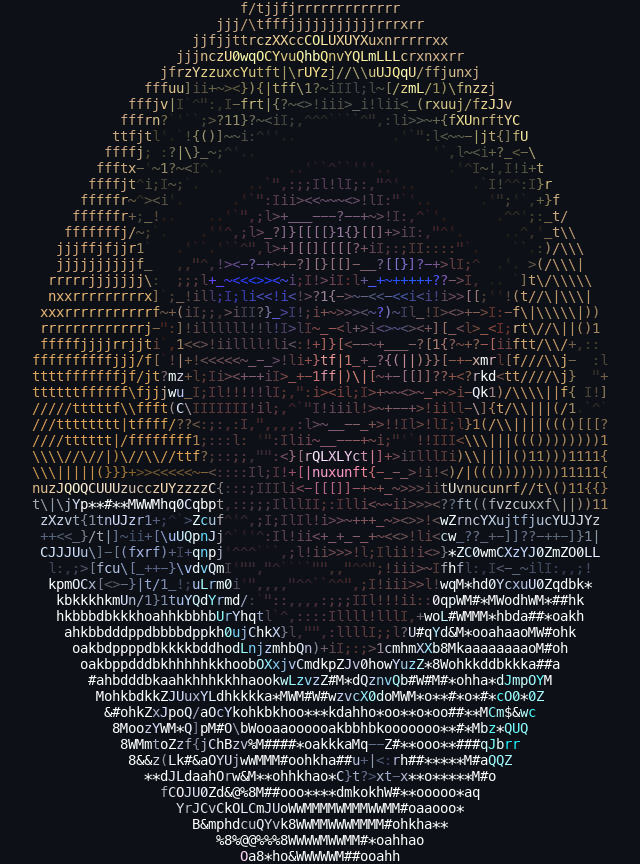
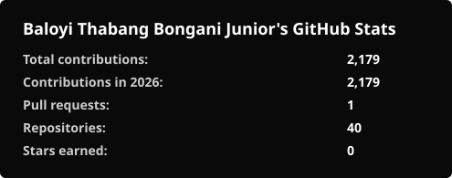
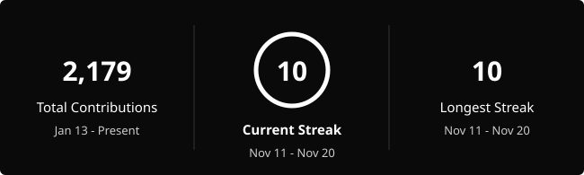

<!--
  GitHub profile README for @thabangTheActuaryCoder
  Hero = colored ASCII portrait (portrait.png) + neofetch-style info panel.
  Keep the info inside <pre> so the columns stay aligned on GitHub.
-->

<table border="0">
<tr>
<td valign="top" width="340">

</td>
<td valign="top">
<pre>
thabang@github
------------------------------------------
OS ........... macOS · Linux
Role ......... Senior Full-Stack AI Engineer @ 4S4
Studied ...... MSc Mathematical Statistics · UFS (Distinction)
PhD .......... Mathematical Statistics · UP (in progress)
IDE .......... VS Code · JupyterLab · RStudio · AntigravityIDE

Lang.Prog .... Python · R · SQL · C# · Java · VBA · MATLAB
Lang.ML ...... TensorFlow · Keras · scikit-learn · PyTorch
Data ......... PostgreSQL · Spark · Databricks · Snowflake · dbt
Cloud ........ AWS · Azure · Docker · GitHub Actions
Lang.Real .... English · Xitsonga

Field ........ Quantitative Finance · Deep Learning · Bayesian
Certs ........ CFA Level I (in progress) · ASSA A112/A113

Hobbies ...... F1 (Ferrari) · Soccer · Running

Contact
Email ........ baloyibongani1@gmail.com
LinkedIn ..... thabang-bongani-junior-baloyi
GitHub ....... thabangTheActuaryCoder
</pre>
</td>
</tr>
</table>

<h3 align="center">Thabang Baloyi</h3>

<b>Quantitative Modelling · Mathematical Statistics · AI &amp; Data Engineering</b>

  
  
  
  

---

### About

Quantitative and AI engineering professional with an MSc in Mathematical Statistics (distinction), backed by training in Statistics & Data Science, Actuarial Science, and quantitative finance. I work across statistical modelling, machine learning, quantitative finance, and data/AI engineering, combining rigorous quantitative analysis with end-to-end engineering.

### Experience

**Senior Full Stack AI Engineer** — *4S4, Cape Town* · Jun 2026 – Nov 2026
 Clients: Rheinmetall Denel Munition, Old Mutual Bank, Ooba, Deloitte
- Led development of EAPP, an enterprise demand and production-planning platform: SAP-derived demand, stock and supply, multi-level BOM explosion, finite work-centre capacity, inventory optimisation and cross-plant scheduling
- Built explainable optimisation workflows (priority allocation, critical-path analysis, Monte Carlo lead-time simulation, linear and lexicographic mixed-integer programming) to recommend feasible production, overtime, transfer and delivery plans
- Implemented Tiffany, an embedded voice and text AI planning co-pilot with structured outputs, audit trails and human confirmation for governed actions
- Built SAP S/4HANA-to-warehouse ETL pipelines and semantic layers, and agentic workflows with n8n, multi-agent systems and RAG

**Artificial Intelligence Engineer** — *Full Stack, Cape Town* · Mar 2023 – May 2026
 Clients: Virgin Active (UK & SA), Expandly
- Designed and built AI-driven, cloud-native applications on AWS and Azure, integrating LLM services, data workflows and Keras models into production
- Developed backend systems, REST APIs and data services for RAG pipelines, embeddings, semantic search and recommendation workflows
- Built data and ML workflows with Python, SQL, Spark, PostgreSQL/pgvector, Databricks, Azure OpenAI and Delta Lake, following medallion-architecture principles
- Implemented CI/CD testing and deployment (Bitbucket Pipelines, GitHub Actions, Azure DevOps, pytest, SonarQube) and AI safety components: guardrails, risk-pattern detection and auditable decision workflows

**AI Machine Learning Engineer Intern** — *Full Stack, Cape Town* · Jan 2023 – Mar 2023
- Built and evaluated classification and regression models (Logistic Regression, Random Forests, XGBoost) with preprocessing and feature-engineering pipelines
- Assisted with Azure OpenAI integrations and Flask REST API deployment on Azure App Service; reported model performance in matplotlib and Power BI

**Junior Data Scientist** — *Discovery Limited, Cape Town* · Jan 2022 – Dec 2022
- Developed, trained and evaluated machine learning models in Python and SQL on large-scale healthcare and operational data
- Set up model monitoring for drift, performance degradation and pipeline integrity, and worked with clinical, actuarial and business stakeholders

**Data Analyst Intern** — *Discovery Limited, Cape Town* · Jan 2021 – Dec 2021
- Analysed large customer datasets with Excel and SQL to deliver insights for customer engagement strategies
- Built automated dashboards and recurring reports on customer and health engagement metrics with Health Actuarial, BI and MI teams

### Education

- **PhD Mathematical Statistics** — University of Pretoria · *in progress*
- **MSc Mathematical Statistics** — University of the Free State · *2026, Distinction (80%)*
- **BSc Honours, Statistics & Data Science** (minor Actuarial Science) — University of Cape Town · *2025*
- **BCom Management Studies** — University of Cape Town · *2022*

### Toolbox

### Certifications &amp; Recognition

`CFA Level I (in progress)` · `ASSA exemptions A112 / A113` 

---

  
  

  

<i>“All models are wrong, but some are useful.” — George Box</i>

